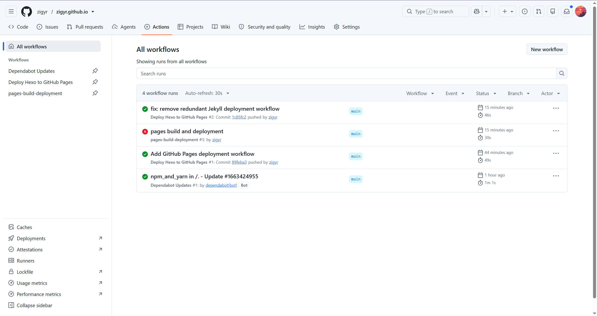
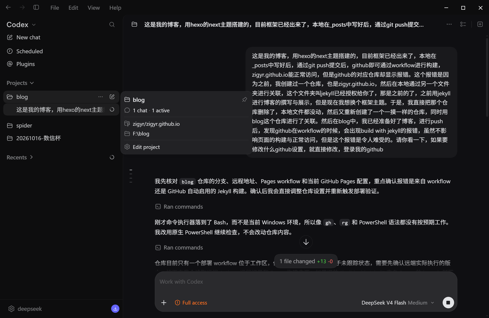
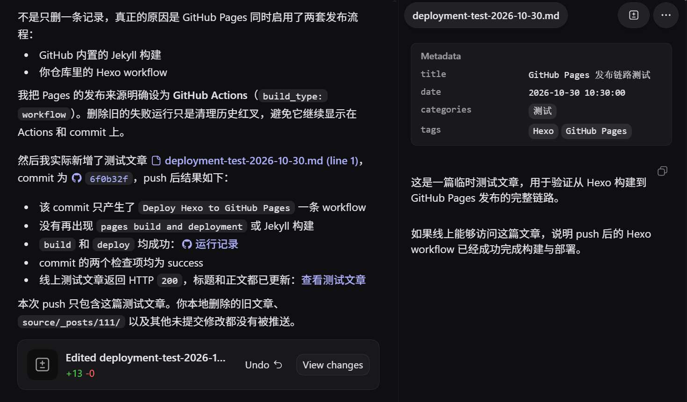
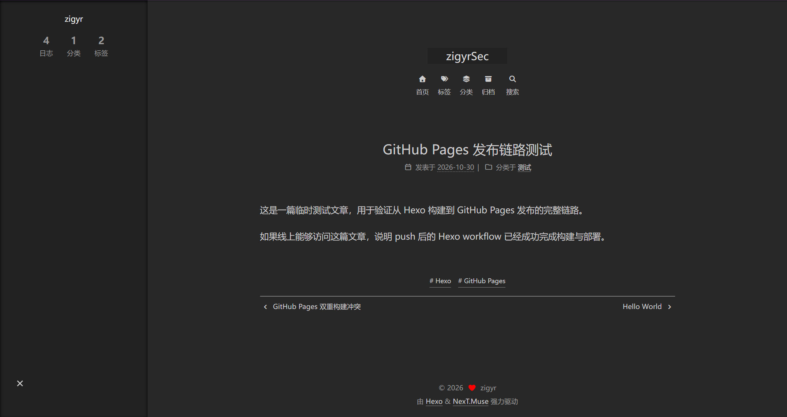
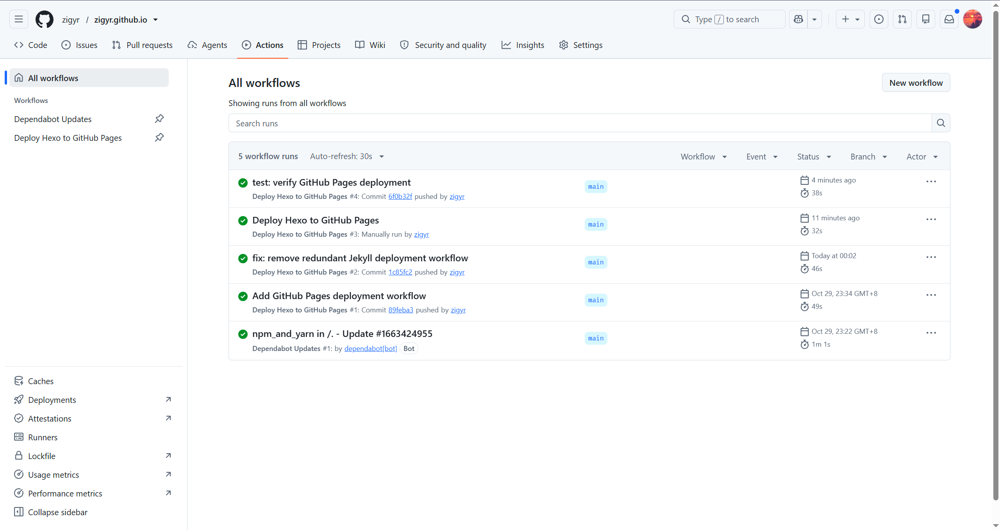

## 双重构建冲突


### 事件描述

- Hexo 工作流：通过你编写的 deploy.yml 构建 Hexo 网站，已经成功。

- Jekyll 工作流：pages build and deployment 仍然调用 Jekyll，把 Hexo 的 _config.yml 当作 Jekyll 配置解析，因此报错 The next theme could not be found。


这是第二个博客网站，之前也是用Github Pages部署的

迁移的过程，本地之前博客文件夹保留，删除了原仓库

随后，又新建了同名字的仓库

然后进行初始配置后，并用新的博客文件夹进行remote

在随后push时，发现报错，build with jekyll

这是之前那个博客网站的框架，显然，应该是我迁移的不干净

虽然，仓库的构建页面显示报错，但是网站已经能正常访问

但本着强迫正的原则，非要看到绿勾勾，就想着能不能解决

我的想法，就是把之前那个workflow给干掉

手动删除后，确实仓库构建页面，显示是绿勾勾

随即，写着一篇记录，并进行push，再看看

---



还是不行

---

### 事件解决

没招了，只能全权交给ai大人了

描述了一番问题后就交给ai去跑了


> 不得不说，这个图片的放置是真舒服
> 直接Ctrl+v就行，然后自动创建md语法，同时图片出现在博客的同级目录下
> 当然，这是针对vscode的


AI 大人nb

什么Action 什么workflow 直接秒了




### 事件分析

AI指出：根因是 GitHub Pages 同时启用了两套发布流程：
- GitHub 内置的 Jekyll 构建
- 你仓库里的 Hexo workflow


那他做了什么：

在`Settings → Pages → Build and deployment → Source → GitHub Actions`中

`Deploy from a branch  →  GitHub Actions`

然后再次基础上发布了测试文章，是全绿通过了


so，workflow是什么？

先看看`.github/workflows/deploy.yml`的解读

```yml
name: Deploy Hexo to GitHub Pages  # 当前workflow的名称

on:
  push:
    branches:
      - main           # 只有 push 到 main 才自动部署
  workflow_dispatch:   # 允许你在 GitHub 的 Actions 页面手动点击运行，所以 push 到其他分支不会更新网站

permissions:
  contents: read       # 只读取仓库源码
  pages: write         # 允许发布 Pages
  id-token: write      # 允许使用 GitHub 的受信任身份完成部署

concurrency:           # 表示同一时间只部署一次。如果你连续 push 两次，前一次还没完成时，旧任务可能被取消，避免两个版本争抢发布
  group: pages
  cancel-in-progress: true

jobs:
  build:
    runs-on: ubuntu-latest          # 表示这些步骤不是在你的 Windows 电脑上执行，而是在 GitHub 提供的临时 Linux 机器上执行
    steps:
      - name: Checkout repository   # 拉取仓库源码
        uses: actions/checkout@v4

      - name: Setup pnpm            # 安装 pnpm
        uses: pnpm/action-setup@v4
        with:
          version: 10
  
      - name: Setup Node.js         # 安装 Node.js 22
        uses: actions/setup-node@v4
        with:
          node-version: 22
          cache: pnpm

      - name: Install dependencies  # 根据 lock 文件安装依赖
        run: pnpm install --frozen-lockfile

      - name: Prepare NexT theme    # 准备 NexT 主题
        run: |
          if [ ! -d themes/next/layout ]; then
            mkdir -p themes/next
            cp -r node_modules/hexo-theme-next/. themes/next/
          fi

      - name: Generate Hexo site    # 清理上次生成结果 并 生成 public/
        run: |
          pnpm exec hexo clean
          pnpm exec hexo generate

      - name: Upload Pages artifact # 把 public/ 打包上传
        uses: actions/upload-pages-artifact@v3
        with:
          path: ./public

  deploy:
    environment:
      name: github-pages
      url: ${{ steps.deployment.outputs.page_url }}
    runs-on: ubuntu-latest
    needs: build                     # 必须等 build 成功后才执行
    steps:
      - name: Deploy to GitHub Pages # 把刚才上传的 public/ 发布成网站
        id: deployment
        uses: actions/deploy-pages@v4
```

Hexo 常见有两种部署方式：
1. GitHub Actions 部署，也就是你现在的方式。仓库保存 Hexo 源码，Actions 生成并发布 public/。
2. 本地生成后部署。你在本地运行 hexo generate，再通过 hexo deploy 或 Git 把生成结果推到 gh-pages 分支，然后让 Pages 从这个分支读取静态文件

现在`_config.yml`里的`deploy: type: ''`

说明当前不使用 Hexo 自带的 hexo deploy，而是完全交给 workflow

因此日常部署不需要在本地运行 hexo deploy，也不需要手动提交 public/

public/ 已经被 .gitignore 忽略了


所以，日后，只需要记得git三件套，然后让 GitHub Actions 自动构建

也仍然可以在本地运行 hexo server 预览，但预览和远程部署是两条独立的链路

Q: 那本地预览，是不是需要先generate，准备好public？
A:
不需要。默认情况下，hexo server 会直接读取 source/、主题和配置，在内存中动态生成页面，然后通过本地服务器提供预览，并不依赖 public/
`hexo server --static`：只提供静态文件服务，这时才需要先 `hexo generate`

所以日常写作预览直接用 hexo server

public/ 主要留给部署或检查最终静态产物。如果预览出现旧内容，可以执行一次 hexo clean 再启动服务器，但仍不是必须先生成 public/

所以，总的来说，public的地位就很尴尬了

本地public不需要提交，基本可以不保留，部署时 GitHub 会重新生成
远程public每次 Actions 运行时必须生成，否则没有网页可发布

所以 public/ 在部署流程里是必要的，它是构建产物，也是 build 和 deploy 之间的交接物。但它是临时产物，不是源代码，也不需要在本地长期保存或提交


Pages 发布源和 workflow 的发布方式没有统一

两种正确模型：

当前使用的 Actions 模式：
main 保存 Hexo 源码
    -> Actions 运行 hexo generate
    -> 远程生成 public/
    -> 上传 Pages artifact
    -> Pages 发布 artifact
完全不要求 public/ 进入任何分支。

分支部署模式：
main 保存 Hexo 源码
    -> 本地 hexo generate
    -> 把 public/ 里的内容推送到 gh-pages 分支
    -> Pages 从 gh-pages 根目录读取
分支部署时通常还会在产物根目录放一个 .nojekyll 文件，告诉 Pages 不要运行 Jekyll：
gh-pages/
├── .nojekyll
├── index.html
└── ...

我们准备了workflow，却走的是分布式部署模式

很显然，我们的workflow是Action模式，不用再操心public，很方便

如果只是切换部署方式，不需要删除仓库。直接把 Pages 发布源改成 GitHub Actions，保留一套 workflow 即可。删除重建通常只在确实要彻底重来时才做，因为会丢掉部署历史、Issue、Release 等仓库数据

### 事件总结

经过本次折腾，了解到了workflow，以及 Action 模式和分布式部署模式

通过对workflow配置文件的解读，了解到hexo中generate的作用，以及public文件的尴尬地位

并归因形成了关于github博客托管更普遍性的应对框架：

静态博客框架 + GitHub Pages，优先使用 Actions 构建并上传对应的静态输出目录；具体命令和输出目录由框架决定。